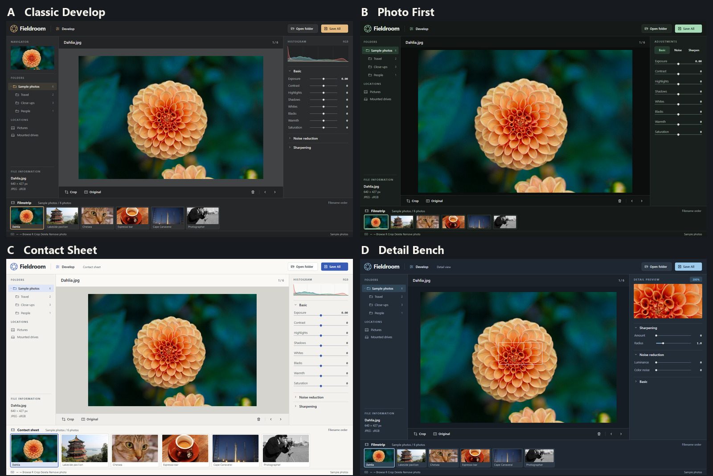

# Fieldroom for Linux

Fieldroom is a folder-based photo editor in development. This first review compares four layouts for browsing, cropping and editing photographs.

[Download the interactive layout picker](https://github.com/Deltaboy1234/First/raw/refs/heads/main/linux-photo-editor/design-review/Fieldroom-Design-Picker.html). Open the downloaded HTML file in a desktop browser. It includes six sample photos and runs offline.

| Layout | What to compare | Develop | Crop |
| --- | --- | --- | --- |
| A · Classic Develop | Graphite workspace with a navigator, RGB histogram and stacked adjustment panels. | [Full size](design-review/screenshots/A-Classic-Develop.jpg) | [Full size](design-review/screenshots/A-Classic-Crop.jpg) |
| B · Photo First | Narrow sidebars, a small filmstrip and tabs for Basic, Noise and Sharpen. | [Full size](design-review/screenshots/B-Photo-First-Develop.jpg) | [Full size](design-review/screenshots/B-Photo-First-Crop.jpg) |
| C · Contact Sheet | Light workspace and large thumbnails for comparing neighboring frames. | [Full size](design-review/screenshots/C-Contact-Sheet-Develop.jpg) | [Full size](design-review/screenshots/C-Contact-Sheet-Crop.jpg) |
| D · Detail Bench | A movable detail preview with 100% and 200% magnification above sharpening and noise reduction. | [Full size](design-review/screenshots/D-Detail-Bench-Develop.jpg) | [Full size](design-review/screenshots/D-Detail-Bench-Crop.jpg) |

## Try one editing pass

1. Use **1–4** to switch layouts. Change the panel width, control spacing and filmstrip size independently.
2. Press **R**, drag a crop corner, then press **Enter**. Go forward one photo with **→** and back with **←** to see the accepted crop.
3. Press **Delete** on a sample. Click **Undo remove** to bring it back. In layout D, click a point in the main image to move the detail preview. Click the percentage to switch magnification.
4. Click **Copy choice** and paste the result into the conversation. Mention any feature you would borrow from a second layout.

The picker edits disposable samples in browser memory. A desktop build for real folders, RAW processing and batch export follows the layout decision.

## Sample photographs

Dahlia is credited to Vultilion and the lakeside pavilion to Daniel Buechele. The preview resizes and crops their photographs under Creative Commons Attribution 2.0. [Dahlia original](https://www.flickr.com/photos/vultilion/6056698931/) · [Pavilion original](https://www.flickr.com/photos/danielbuechele/6061409035/) · [License](https://creativecommons.org/licenses/by/2.0/)

Chelsea is by Stefan van der Walt, Espresso bar by Rachel Michetti and Photographer by Lav Varshney. All three are CC0. SpaceX released its DSCOVR launch photograph into the public domain. [Sample image credits](https://scikit-image.org/docs/stable/api/skimage.data.html)
